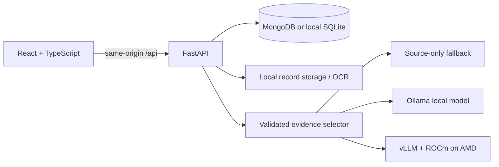

# HealthBridge

A clearer path to care. A working, synthetic-data healthcare handoff prototype: patient intake → records → source-linked visit brief → clinician review → patient instructions.

## Run locally

Requires Node.js 22+ and Python 3.12+. No cloud account or API key is required for source-only mode.

```sh
python3 -m venv .venv
.venv/bin/pip install -r backend/requirements.lock.txt
npm ci --prefix frontend
```

Start these in separate terminals from the repository root:

```sh
.venv/bin/uvicorn app.main:app --app-dir backend --host 127.0.0.1 --port 8000 --reload --reload-dir backend/app
```

```sh
npm --prefix frontend run dev
```

Open http://127.0.0.1:5173. Vite proxies `/api` to FastAPI. All clinical data and workflow state are fetched from the backend and persisted in MongoDB when configured, or SQLite for offline development. No frontend fixture database or localStorage business state.

Optional OCR: install Tesseract using your OS package manager (`brew install tesseract` on macOS, `apt install tesseract-ocr` on Debian). Text PDFs and TXT files work without it. Scanned PDFs and images require it. Default OCR language is English; multilingual typed intake is supported. Do not claim validated multilingual OCR.

## Demo accounts

Use the patient/clinician buttons on the login page. Credentials are supplied by the demo-only backend endpoint:

| Role | Email | Password |
| --- | --- | --- |
| Patient | patient@healthbridge.demo | BridgeDemo2026! |
| Clinician | doctor@healthbridge.demo | BridgeDemo2026! |

These are public synthetic demo accounts, not production credentials. Database and uploads live in `backend/data/` (gitignored). Set `DATA_DIR` to use another directory. Data survives application restarts. The seed is inserted only when the user table is empty.

## What works

- Patient and clinician login with scrypt-hashed passwords, expiring HttpOnly sessions, and strict role/assignment authorization.
- Persistent intake in the patient's own words with regional interface language support (English, Hindi, Kannada).
- Durable document upload queue with lease expiry, duplicate SHA-256 detection, bounded extraction/OCR, and extraction provenance.
- Clinician document corrections with recorded rationale and immutable version references.
- Schema 2.0 structured visit brief with 4 clinician-ready sections, coverage metrics, and visible conflict/uncertainty detection (e.g. conflicting allergy records).
- Clinician-patient clarification lifecycle with threaded discussion and clinician-only resolution.
- Clinician-authored original, plain-language, and reviewed translated instructions with immutable versioning (`v1`, `v2`), override notes, and version-bound patient acknowledgement.
- Scoped record removal with tombstone tracking that immediately marks dependent briefs as `outdated`.
- Portable care summary export (JSON format) and printable visit brief (Save as PDF).
- Responsive layout, keyboard-accessible dialogs, dark/light themes, and local typography.

## AI modes and honest limits

Default `AI_BACKEND=extractive` is deterministic source selection, **not LLM inference**. It makes development and demonstrations possible without downloading a model or using credits. AI mode calls an OpenAI-compatible endpoint, validates JSON, and strictly rejects any excerpt that is not present verbatim in its source document. Invalid output gets one retry; endpoint failures are visible errors, never silently replaced with a fake AI result.

The current model task is evidence selection, not diagnosis, automatic translation, or medical simplification. Source fidelity does not establish clinical correctness. Clinicians author the plain-language and translated instructions and confirm each version. Translations in the synthetic seed are examples, not validated clinical translations. Interface labels, forms, profile/privacy text, system activity labels, and dates support English, Hindi, and Kannada. Patient prose, document text, and clinician-authored clinical content retain their original language; changing the interface language does not translate those records.

For local inference, install Ollama separately, download an appropriate model, and start the API with:

```sh
AI_BACKEND=ollama AI_BASE_URL=http://127.0.0.1:11434/v1 AI_MODEL=qwen2.5:7b \
  .venv/bin/uvicorn app.main:app --app-dir backend --host 127.0.0.1 --port 8000
```

See [AMD deployment](docs/AMD.md). Real AMD execution still needs to be performed and evidenced. Configuration alone does not satisfy the hackathon requirement.

## Docker

```sh
docker compose up --build
```

Open http://localhost:8080. Nginx serves the built frontend and proxies the backend. MongoDB stores records and uploaded bytes when configured; local SQLite uses a named volume. Docker includes Tesseract. The private root `.env` is read by both the application and Docker Compose; explicit process variables take precedence. Do not use the local development `.env.example` CORS values unchanged on a different public origin.

Use TLS and `COOKIE_SECURE=true` for any public demonstration. Set `CORS_ORIGINS` to the exact external origin. This is a **synthetic-data prototype**, not a production health-record system or a compliance-certified service. `DEMO_ENABLED=false` hides demo credential discovery and disables seeding; it does not revoke existing seeded accounts. There is no production registration/provisioning flow.

## Verification

Run all baseline checks:

```sh
npm --prefix frontend run build
npm --prefix frontend test
PYTHONPATH=backend .venv/bin/pytest backend/tests -q
node frontend/tests/connection.mjs
docker compose config --quiet
.venv/bin/python scripts/release_check.py
```

- **41 backend tests** verify persistence through the handoff, authorization, invalid/stale review prevention, upload queue leases, extraction provenance, conflict detection, and instruction versioning.
- **23 frontend tests** verify dialog context isolation, save/refresh retry semantics, session expiry, storage fallback, and 100% UI key parity in Hindi and Kannada.
- **HTTP connection test** runs the actual frontend API module against temporary FastAPI/SQLite servers over loopback.
- **Submission preflight** (`scripts/release_check.py`) conservatively evaluates local gates (`local_ready: true`).

See [verification results](docs/VERIFICATION.md) and [handoff status](HANDOFF.md) for exact checks performed and remaining limitations.

## Stage D — Production Readiness Backlog

This application is a **synthetic-data hackathon prototype**. The following workstreams are explicitly tracked for future production readiness and must be implemented before handling real patient data:

1. **Email Ownership & Recovery:** Real SMTP/provider integration, expiring hashed verification tokens, session revocation.
2. **Professional Identity & Credentialing:** Verified medical organization onboarding, clinician licensing checks, privilege escalation restrictions.
3. **Staff Roles & Least Privilege:** Role-based access control (owner, clinician, staff), multi-clinician assignment workflows.
4. **Consent & Privacy:** Versioned consent tracking, processor disclosures, retention/revocation policies, patient data export/deletion receipts.
5. **Operational Security & Backup:** Distributed rate limiting, storage quotas, encrypted automated backups with verified restore drills.

## Architecture



We deliberately defer billing, insurance, hospital administration, medication reminders, voice, vector databases and fine-tuning. One reliable care handoff is the hackathon focus.

[Hackathon findings and submission checklist](docs/HACKATHON.md) · [Demo script](docs/DEMO.md) · [Project plan](PROJECT_PLAN.md) · [Continuation memo](HANDOFF.md)

MIT license. Model and dependency licenses remain their own.

## Submission preparation

Draft copy is in `submission/PROJECT_DESCRIPTION.md`; recording narration and deck outline are in `submission/PITCH_SCRIPT.md`. These are preparation assets, not a finished video or deck. Run `.venv/bin/python scripts/release_check.py` for a conservative readiness checklist. CI is configured in `.github/workflows/ci.yml` to run builds, tests, real client/API checks and Docker build after publication; it has not yet run on GitHub.

## MongoDB and Render

The root Dockerfile serves the production frontend and API from one service. `render.yaml` supplies deployment settings; enter `MONGODB_URI` privately. Read [manual setup](docs/MANUAL_SETUP.md) and [track alignment](docs/TRACK_READINESS.md) before submission. Uploaded file bytes now persist in the database. Atlas errors are explicit and never switch you silently to a local database.

Appointment details are editable and API-backed; they do not book a clinic visit. Care-content language options are supplied by `/api/languages`: 28 languages organized by region. Three complete interface languages remain English, Hindi and Kannada; clinical translations require clinician authorship/review.

Optional live Atlas regression tests create and remove uniquely named test databases (requires permissions to create/drop those databases):
```sh
HEALTHBRIDGE_TEST_MONGO=1 PYTHONPATH=backend .venv/bin/pytest backend/tests -q
HEALTHBRIDGE_TEST_MONGO=1 node frontend/tests/connection.mjs
```
Regular tests explicitly select isolated SQLite and never mutate your local or Atlas workspace.

## Patient and hospital onboarding

Create account supports a patient or self-registered hospital/clinic owner. Fresh accounts have empty clinical workspaces. Hospital owners invite patients from the Patients page; a 24-hour, single-use, email-bound token adds an explicit assignment after patient acceptance. Existing patients can accept from their profile. Hospital identity, staff licensing and email ownership are not verified in this prototype; password recovery and multi-staff administration are not implemented. Keep all data synthetic.

Back/forward controls use real browser history. Horizontal trackpad navigation is supported while preserving scrolling in fields, dialogs and tabs. Native browser/OS gestures still need a manual hardware check.
